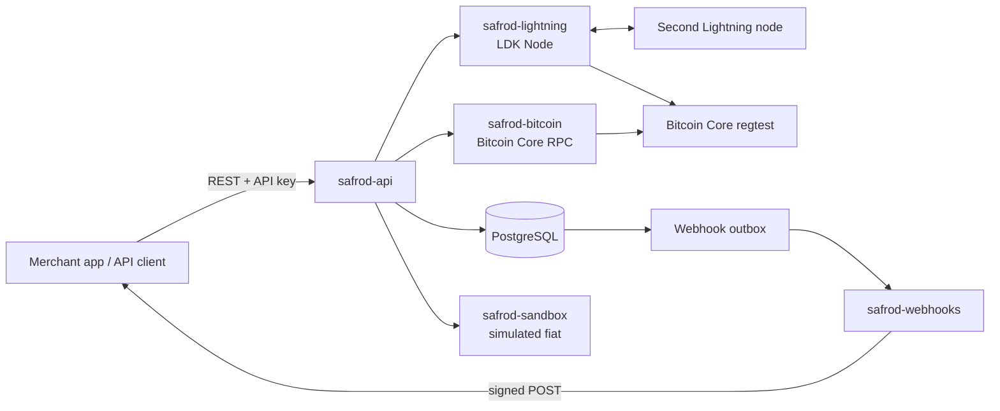

# Safrod

[](https://github.com/Alkamal01/Safrod/actions/workflows/ci.yml)
[](https://www.rust-lang.org/)
[](#license)

**Open-source, self-hostable Bitcoin and Lightning payment infrastructure.**

Safrod gives developers a payment backend for Bitcoin and Lightning that they can run and inspect themselves. It is written in Rust, uses LDK Node for Lightning and Bitcoin Core for chain data, and exposes a REST API with observable payment states, signed webhooks and a durable ledger.

> **Status: hackathon prototype.** Everything runs on Bitcoin **regtest** and the daemon refuses to start on mainnet. It is not audited and must not hold real funds. [`docs/progress.md`](docs/progress.md) lists what was run end to end and what was only written.

## Overview

Lightning makes Bitcoin payments fast and cheap, but a product built on it still needs wallet and key handling, a Bitcoin connection, channel and liquidity management, durable payment state, failure handling and a predictable interface for applications. Small teams usually assemble those from several libraries or depend on a hosted provider, which makes the result hard to self-host, inspect or customise.

Safrod targets that application-infrastructure gap. It builds on established projects instead of reimplementing them, and it is not a new blockchain, token or replacement for Lightning.

- **Open and self-hostable.** The whole stack runs from this repository.
- **Developer experience.** Resource-oriented API, scoped API keys, idempotency keys, one error shape, pagination, an OpenAPI document.
- **Reliability.** Payment state is durable and every transition is validated. A timeout is never treated as a failure; ambiguous payments become `unknown` and are reconciled, not retried blindly.
- **Operator control.** The operator runs the node, holds the keys and owns the database. This is *not* a self-custodial wallet for end users.
- **Modular.** Bitcoin and Lightning are the core. Fiat, FX and cross-border flows exist only as a clearly labelled **simulation** for integration testing.

It is for wallet and merchant developers who want a self-hostable payment backend, and for Bitcoin infrastructure contributors.

**What Safrod does not do:** real NGN/KES or other fiat payouts, FX execution, KYC/AML, stable-value guarantees, atomic fiat settlement or mainnet support. Sandbox endpoints are simulations and say so in every response.

## What works today

| Area | Status |
| --- | --- |
| Two independent LDK Node nodes with a real channel on regtest | working |
| Lightning invoices, payments, events, idempotency, failure and `unknown` handling | working |
| On-chain deposit address and confirmation tracking via Bitcoin Core | working |
| Signed webhooks (outbox, retry, replay, SSRF guard) | working |
| Scoped API keys, operator token, OpenAPI, dashboard | working |
| Simulated quotes and payouts (success, failure, timeout) with a real regtest BTC leg | simulated |
| Docker Compose stack, GitHub Actions run | written, not yet run |

The detailed matrix is in [`docs/architecture.md`](docs/architecture.md).

## Architecture



| Crate | Role |
| --- | --- |
| `safrod-core` | ids, integer money types, state machines, API keys, webhook signing |
| `safrod-storage` | PostgreSQL schema, repositories, outbox |
| `safrod-lightning` | backend trait, LDK Node adapter, in-memory mock |
| `safrod-bitcoin` | Bitcoin Core RPC client, deposit watcher |
| `safrod-webhooks` | signed delivery worker, SSRF guard |
| `safrod-sandbox` | deterministic simulated quotes and payouts |
| `safrod-api` | Axum router, auth, payment engine, OpenAPI |
| `safrod` | the daemon |
| `examples/merchant` | example merchant app (Node) |
| `legacy/settlement` | the first-iteration Core Lightning settlement prototype, kept for reference |

Read [`docs/architecture.md`](docs/architecture.md), [`docs/adr/0001-lightning-node-choice.md`](docs/adr/0001-lightning-node-choice.md) and [`docs/upstream-audit.md`](docs/upstream-audit.md) for the design, the LDK Node versus rust-lightning trade-off and the upstream commits and licenses inspected.

## Payment lifecycle

**Receiving.** The API asks the node for a BOLT11 invoice and stores it `open`. When LDK Node reports `PaymentReceived`, the event is recorded under a dedupe key, the invoice becomes `paid`, an `invoice.paid` event and its webhook deliveries are written in the same database transaction, and only then is the node event acknowledged.

**Sending.** The client supplies an `Idempotency-Key`. Safrod stores the payment as `created`, then `pending`, and only then asks the node to send. `PaymentSuccessful` and `PaymentFailed` make it final. After a restart, in-flight payments are reconciled against the node; if the node has no answer the payment is `unknown`, never `failed`.

```text
created -> pending -> succeeded
                  \-> failed
                  \-> unknown -> succeeded | failed
```

A client timeout is not proof that a payment failed. Retry with the same `Idempotency-Key` to read the stored payment.

## Run it

Needs Rust, Docker or (without Docker) `bitcoind`, Node 20, `psql` and a PostgreSQL server. Full instructions, expected output and reset steps are in [`docs/demo.md`](docs/demo.md).

```bash
make up && make setup && make demo     # Docker Compose (see status above)
make reset                             # clean slate
```

Native, without Docker (this is the path that has been run end to end):

```bash
export BITCOIN_BIN=/path/to/bitcoin/bin SAFROD_DEV_PG_URL=postgres://user@127.0.0.1:5432
cargo build -p safrod
scripts/dev-native.sh start && scripts/setup.sh && scripts/demo.sh all
```

The demos: **1** real Lightning (invoice, second node pays, event, webhook, merchant shows paid), **2** on-chain deposit with confirmations, **3** simulated fiat/FX sandbox with real regtest BTC settlement, plus restart recovery. Each script asserts its outcome.

## API

Interactive docs at `/docs`, raw document at `/openapi.json`, conventions and examples in [`docs/api.md`](docs/api.md).

```http
POST /v1/lightning/invoices          POST /v1/lightning/payments
GET  /v1/lightning/invoices/{id}     GET  /v1/lightning/payments/{id}
POST /v1/bitcoin/addresses           GET  /v1/bitcoin/transactions/{id}
GET  /v1/balances   GET /v1/events   POST /v1/webhook-endpoints
POST /v1/sandbox/quotes              POST /v1/sandbox/payouts    # simulated
GET  /healthz       GET /readyz      GET  /dashboard
```

The API is original. It borrows general conventions from public API design (typed statuses, request identifiers, signed webhooks) and makes no compatibility claim with any third-party API.

## Configuration

Environment variables, with fake development values in [`.env.example`](.env.example): `SAFROD_DATABASE_URL`, `SAFROD_BITCOIN_RPC_URL/_USER/_PASSWORD`, `SAFROD_ADMIN_TOKEN` (24+ chars; the admin API is off without it), `SAFROD_BIND` (loopback by default), `SAFROD_LDK_STORAGE_DIR`, `SAFROD_LDK_LISTEN`, `SAFROD_REQUIRED_CONFIRMATIONS`. Development switches `SAFROD_ENABLE_DEV_ENDPOINTS` and `SAFROD_WEBHOOK_ALLOW_PRIVATE` exist for the demo stack and are refused or off by default. Secrets belong in the environment or a secret manager, never in the repository.

## Security

Read [`docs/threat-model.md`](docs/threat-model.md) before running this anywhere you care about. The short version: unaudited; operator-custodied keys stored unencrypted at rest; webhook secrets stored in clear; no TLS, rate limiting or per-project spending limits; shared node liquidity across projects. Report vulnerabilities privately as described in [`SECURITY.md`](SECURITY.md).

## Development

```bash
cargo fmt --all -- --check
cargo clippy --workspace --all-targets --all-features -- -D warnings
DATABASE_URL=postgres://user@127.0.0.1:5432/postgres cargo test --workspace   # needs CREATEDB
(cd examples/merchant && node --test)
```

CI runs the same checks plus `cargo deny` and a regtest end-to-end job. See [`CONTRIBUTING.md`](CONTRIBUTING.md).

## Roadmap

Planned, not shipped: per-project spending limits, rate limiting and TLS guidance, encrypted webhook secrets, reorg handling for deposits, a typed client generated from the OpenAPI document, an optional compatibility adapter with a precise coverage table, and evaluation of Spark and UMA integrations behind disabled-by-default flags. See [`docs/implementation-plan.md`](docs/implementation-plan.md).

## License

Dual-licensed under [MIT](LICENSE-MIT) or [Apache-2.0](LICENSE-APACHE), at your option. All direct and transitive dependencies are MIT, Apache-2.0 or similarly permissive; the allow-list and the one file-level copyleft exception (MPL-2.0 `webpki-roots`, unmodified) are in [`deny.toml`](deny.toml). Third-party attribution and the upstream audit are in [`docs/upstream-audit.md`](docs/upstream-audit.md). Pinned dependency versions are in `Cargo.lock`.
