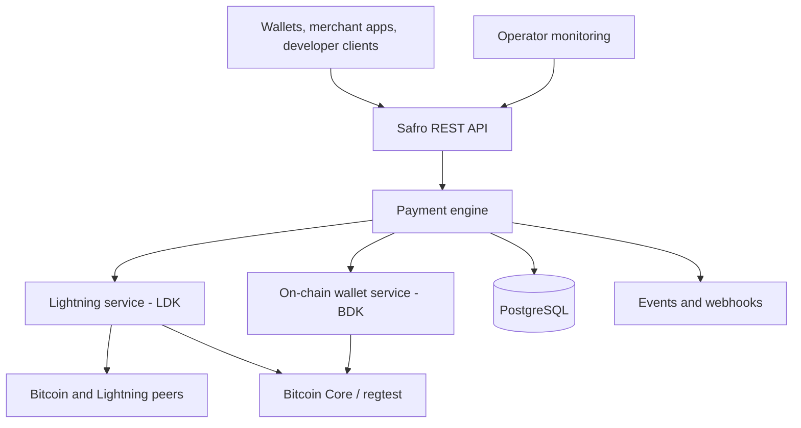

# Safro

[](https://github.com/Alkamal01/Safrod/actions/workflows/ci.yml)
[](https://www.rust-lang.org/)
[](#license)

**Open-source, self-hostable Bitcoin and Lightning payment infrastructure.**

Safro gives developers a foundation for integrating Bitcoin payments into their applications without building and operating a payment orchestration layer from scratch. It is Rust-first, uses the Lightning Development Kit (LDK) for Lightning functionality, and is designed around clear APIs, observable payment states, and operator control.

> **Project status: hackathon prototype / active development.** This README describes the intended architecture and initial demo scope. Features are not considered implemented or production-ready unless verified in the repository. The demo runs on a local Bitcoin **regtest** network and does not process real funds.

## Overview

Lightning makes Bitcoin payments fast and inexpensive, but a reliable product on top of it still needs wallets and keys, a Bitcoin connection, channel and liquidity management, durable payment state, failure handling, and a predictable interface for applications. Small teams usually assemble these pieces from several libraries or depend on a hosted provider, which makes the infrastructure hard to self-host, inspect, or customize.

Safro targets that application-infrastructure gap: the software between Bitcoin/Lightning primitives and the products people use. It is a modular payment backend that builds on established Bitcoin projects rather than reimplementing the protocol. It is **not** a new blockchain, token, or replacement for Lightning.

Design goals:

1. **Open infrastructure:** inspect, run, and extend the software without a proprietary payment backend.
2. **Developer experience:** consistent payment APIs, explicit status transitions, useful errors, and event notifications.
3. **Operator control:** node, wallet, and infrastructure operations stay under the deployer's control.
4. **Reliability:** payment attempts are durable, retries are explicit, and ambiguous outcomes are reconciled rather than guessed.
5. **Modularity:** Bitcoin and Lightning are the core; other payment capabilities are separate integrations.

**Who it is for:** wallet developers, merchants and payment platforms, startups and independent developers who want a self-hostable backend, and Bitcoin infrastructure contributors. The initial focus is developers and operators; end-user apps integrate through the API.

## Scope and capabilities

| Area | Intended capability | Initial scope |
| --- | --- | --- |
| Lightning payments | Create invoices, send payments, inspect outcomes | **Core demo target** |
| Bitcoin on-chain | Wallet operations, receive addresses, broadcast and track transactions | **Core integration target** |
| Payment engine | Persist payment intents, states, and attempts | **Core demo target** |
| Developer interface | REST API and event/webhook interface | **Core demo target** |
| Node operations | Lightning node status and basic operational visibility | **Core demo target** |
| Liquidity | Channel balance and payment-capacity visibility | Initial monitoring |
| Dashboard | Operator-facing transaction and node overview | Optional demo component |
| SDKs | Typed client libraries | Post-prototype |
| Fiat and FX | Provider adapters, quotes, and payout integrations | Future module |
| Cross-border payments | Settlement orchestration across providers | Future module |
| Escrow | Conditional release, refund, and dispute workflows | Future module; not in the initial demo |
| Stable-value payments | Fiat-denominated payment integrations and risk controls | Research / future module |

Lightning transfers BTC. It does not by itself provide local-currency payouts, exchange-rate guarantees, or protection from Bitcoin price volatility.

## Architecture



**API layer.** Validates requests, authenticates callers, exposes payment operations, and returns stable identifiers. Applications do not need direct access to node internals.

**Payment engine.** Owns the application-level payment lifecycle: records attempts and outcomes, applies idempotency rules, and coordinates notifications. It must not report a payment as settled before the underlying payment system confirms settlement.

**Lightning service.** Integrates LDK for invoices, payments, channel state, and events. LDK is a library; a reliable node also needs networking, persistence, chain monitoring, and wallet integration.

**On-chain wallet service.** Uses BDK and Bitcoin Core for wallet operations and blockchain access. Key ownership and responsibilities must be explicit.

**Persistence and events.** PostgreSQL stores application state and event delivery records, which is essential for safe restarts and reconciliation.

**Optional modules.** Fiat adapters, FX, cross-border orchestration, stable-value products, and escrow are deliberately outside the initial core.

**Trust boundaries.** Self-hosting gives operators control of their deployment; it does not automatically make an application non-custodial. Custody depends on how keys, funds, and payment authorization are implemented. Bank, fiat-provider, and other network integrations bring their own trust and compliance requirements.

## Payment lifecycle

**Receiving a Lightning payment**

1. An application requests an invoice through Safro.
2. Safro asks the Lightning service to create the invoice and records its identifier.
3. The application presents the invoice to the payer.
4. LDK reports the payment outcome to the backend.
5. Safro persists the result and exposes it through the API and event notifications.

**Sending a Lightning payment**

1. The application submits a payment request with a stable idempotency key.
2. Safro validates the request and records a payment attempt.
3. The Lightning service attempts the payment through LDK.
4. Safro tracks the attempt until a definitive success or failure is known.
5. The application reads the final state or receives a webhook.

A timeout from the API is **not** proof that a Lightning payment failed. Clients should query the existing payment before submitting a new attempt.

```text
CREATED -> PENDING -> SUCCEEDED
                  \-> FAILED
```

The implementation must distinguish retryable attempts from final outcomes and reconcile interrupted operations after restart. State names and API fields are not a public contract until finalized against the code.

## Technology

| Layer | Technology | Role |
| --- | --- | --- |
| Language | Rust | Backend services and payment logic |
| Lightning | [LDK / rust-lightning](https://github.com/lightningdevkit/rust-lightning) | Lightning protocol integration |
| Bitcoin wallet | [BDK](https://github.com/bitcoindevkit/bdk) | Wallet building blocks |
| Bitcoin node | [Bitcoin Core](https://github.com/bitcoin/bitcoin) | Blockchain validation and RPC |
| Persistence | PostgreSQL | Payment and event records |
| Packaging | Docker | Reproducible local services |
| Test network | Bitcoin regtest | Local testing without real funds |
| Client interface | REST / JSON, webhooks | Application integration |

The web framework, database schema, and SDK choices should follow the implementation rather than be claimed in advance.

## Local development and demo

**Network:** Bitcoin regtest, a local Bitcoin network where blocks are mined on demand. It is distinct from mainnet, public testnet, and simulated payment mocks.

**Prerequisites:** Rust toolchain (`rustup`, `cargo`), Docker and Docker Compose, Git, and a local Bitcoin Core regtest node or the project's containerized regtest environment.

```bash
git clone https://github.com/Alkamal01/Safrod.git
cd Safrod

cargo fmt --all -- --check
cargo test --workspace
```

> **Maintainer TODO:** add a tested, copy-pasteable command sequence that starts regtest, the Safro service, and the demo client, plus any `.env.example` and migrations. Never commit real secrets.

A reproducible demonstration should show:

1. Starting the local Bitcoin regtest environment.
2. Starting the Safro service and its Lightning dependencies.
3. Creating a Lightning invoice through the API.
4. Paying the invoice from a separate local Lightning participant.
5. Observing the payment transition to a settled state.
6. Receiving or querying the resulting confirmation event.
7. Demonstrating at least one failure or restart-recovery scenario.

> **Demo evidence:** add a link to a recorded walkthrough, sample requests/responses, and passing CI results when available. Do not label a flow complete until it has been exercised end to end.

## API design

The intended API is resource-oriented and centered on stable identifiers. These endpoint shapes are **illustrative**, not a claim that they exist:

```http
POST /v1/lightning/invoices
POST /v1/lightning/payments
GET  /v1/payments/{payment_id}
GET  /v1/node/status
GET  /v1/channels
```

Clients should be able to request invoices and payments with validated inputs, retrieve state by stable ID, retry safely with idempotency keys, receive signed and retryable event notifications, and distinguish validation errors, temporary infrastructure failures, and final payment failures.

Authentication, rate limits, pagination, webhook verification, and versioning must be specified and tested before any public deployment.

## Reliability and security

- **No silent duplicate payments:** retries must not create unintended additional transfers.
- **Durable state:** attempts and outcomes survive process restarts.
- **Explicit monetary units:** integer amounts, with satoshis and millisatoshis kept distinct.
- **No secret leakage:** never log seeds, private keys, payment preimages, API credentials, or sensitive user data.
- **Verified outcomes:** settlement is never inferred from an HTTP response alone.
- **Minimal privileges:** isolate wallet keys, administrative operations, and client permissions.
- **Fail safely:** surface uncertain outcomes and reconcile them before retrying external financial actions.
- **Threat modeling:** document trust boundaries, operator assumptions, and third-party integration risks.

The prototype is **not audited** and must not be used to hold or process real funds.

## Roadmap

Roadmap items are planned work, not shipped functionality.

| Milestone | Focus | Evidence of completion |
| --- | --- | --- |
| **v0.1: Local payment prototype** | Regtest environment, Lightning send/receive, durable payment state, basic API | Reproducible end-to-end demo and tests |
| **v0.2: Operator experience** | Node and channel monitoring, webhook delivery, documentation | Operator demo and integration examples |
| **v0.3: Developer tooling** | SDKs, stronger API contracts, integration test harness | Published examples and compatibility tests |
| **v0.4: Payment extensions** | Evaluate Spark/UMA integrations and optional fiat-adapter interfaces | Documented proof of concept and trust model |
| **Later** | FX, cross-border orchestration, stable-value flows, conditional payments | Separate design proposals, security reviews, real-world validation |

New modules are added only when they solve validated problems and do not weaken the reliability of the core.

## How we evaluate the prototype

| Criterion | What to demonstrate |
| --- | --- |
| Functionality | A real regtest Lightning payment initiated and observed through Safro |
| Correctness | Tests for success, failure, duplicate requests, and restart recovery |
| Developer experience | Clear setup, example requests, and useful error responses |
| Self-hosting | A reproducible local deployment without a proprietary payment backend |
| Observability | Payment status, logs, and events without exposing secrets |
| Open-source quality | Readable Rust code, tests, CI, contribution docs, and license |

**Results:** add measured results, demo links, test logs, and limitations after running the prototype. Avoid unverified claims about performance, cost, reliability, or adoption.

## Contributing

Contributions, issue reports, tests, and documentation improvements are welcome. Open an issue before substantial design changes, keep changes focused, add regression tests for bug fixes where practical, and explain the problem, approach, trade-offs, and testing.

```bash
cargo fmt --all -- --check
cargo clippy --workspace --all-targets -- -D warnings
cargo test --workspace
```

See [CONTRIBUTING.md](CONTRIBUTING.md) for the full process. Review and release decisions remain with the maintainers.

## Security

Do not publicly disclose exploitable vulnerabilities before maintainers have had a reasonable opportunity to investigate. Follow the private reporting process in [SECURITY.md](SECURITY.md).

## License

Safro is dual-licensed under MIT or Apache-2.0, at your option. The package manifest declares the license; the full license texts will be added before the first public release.

---

**Safro's aim:** make Bitcoin and Lightning payment infrastructure easier to run, understand, and integrate, while keeping the core open and under developers' control.
