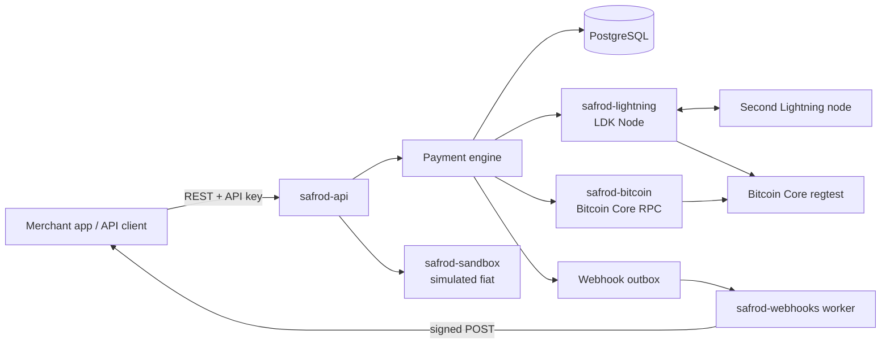

# Architecture

Safrod is a self-hostable Bitcoin and Lightning payment backend. It runs against Bitcoin **regtest**; mainnet is refused at startup.

## Crates

| Crate | Responsibility |
| --- | --- |
| `safrod-core` | Identifiers, integer money types, status state machines, API key hashing, webhook signing. No I/O. |
| `safrod-storage` | PostgreSQL schema, migrations and repositories. All state transitions are validated here inside transactions. |
| `safrod-lightning` | `LightningBackend` trait and the LDK Node implementation: invoices, payments, channels, balances, node events. |
| `safrod-bitcoin` | Bitcoin Core JSON-RPC client and the deposit watcher that tracks confirmations. |
| `safrod-webhooks` | Endpoint URL validation (SSRF), delivery worker, retry and backoff. |
| `safrod-sandbox` | Deterministic simulated quotes and fiat payouts. Never touches funds. |
| `safrod-api` | Axum router, authentication, OpenAPI document, error mapping. |
| `safrod` | The daemon: configuration, wiring, background tasks, graceful shutdown. |
| `legacy/settlement` | The first-iteration Core Lightning settlement prototype, kept for reference. Not part of the service. |

## Data flow

**Incoming Lightning payment.** The API asks the node for a BOLT11 invoice and stores it as `open`. When LDK Node emits `PaymentReceived`, the daemon records the event in `node_events` keyed by the payment hash (duplicates are ignored), moves the invoice to `paid` in the same transaction, and writes an `invoice.paid` event plus webhook outbox rows. Only then is the node event acknowledged.

**Outgoing Lightning payment.** The API stores a `created` payment under the caller's idempotency key, then asks the node to send. `pending` is persisted before the HTLC is dispatched. `PaymentSuccessful` and `PaymentFailed` are the only events that make a payment final. If the process restarts while a payment is `pending`, reconciliation compares it with the node's payment list; if the node cannot answer, the payment becomes `unknown`, never `failed`.

**On-chain deposit.** The API derives an address from the node wallet and stores it. The watcher scans Bitcoin Core for outputs paying stored addresses and records confirmation counts. Status moves `awaiting → unconfirmed → confirming → confirmed`, emitting an event on each change.

**Webhooks.** Events and their delivery rows are written in one transaction (a transactional outbox). A worker delivers them with at-least-once semantics; receivers deduplicate on the event id.

## Trust and custody

The operator runs the node and holds its keys on disk. Safrod is a self-hosted service, not a self-custodial wallet; there is no end-user key custody. See `docs/threat-model.md`.

## Real and simulated boundaries

Everything under `/v1/lightning` and `/v1/bitcoin` is backed by real regtest Lightning and Bitcoin Core. Everything under `/v1/sandbox` is simulated, and every response carries `"simulated": true`. A sandbox payout can be paired with a real regtest Lightning payment, but the fiat leg is always synthetic.

## Feature matrix

Status is one of **working** (run end to end, see `docs/progress.md`), **simulated** (deterministic, no funds), **experimental** (exists, little verified), **planned**.

| Capability | Status |
| --- | --- |
| Bitcoin Core regtest with two independent LDK Node nodes and a real channel | working (native runner) |
| Lightning invoice create/read; `paid` from node events | working |
| Lightning payment send with idempotency, `pending`/`unknown`/`failed` handling | working |
| Restart recovery for incoming payments after `kill -9` | working |
| Reconciliation of in-flight outgoing payments after a crash | experimental (mock and database tested; not reproduced on a real in-flight HTLC) |
| On-chain address, deposit detection and confirmation tracking | working (regtest) |
| API keys with scopes, hashed storage; operator token | working |
| Signed webhooks with transactional outbox, retries, replay, SSRF guard | working |
| OpenAPI document and Swagger UI | working (UI loads assets from a CDN) |
| Operator dashboard | working, minimal |
| Visual test flow builder | adapted Next.js app, browser behavior not verified; generates Safrod API recipes |
| Sandbox quotes and payouts (success, failure, timeout) | simulated; BTC leg real on regtest |
| Docker Compose stack | experimental (written, not run) |
| CI workflow | experimental (written, not run on GitHub) |
| Core Lightning settlement prototype (`legacy/settlement`) | experimental, unit-tested only |
| Per-project spending limits, rate limiting, TLS, encrypted webhook secrets | planned |
| Reorg handling for deposits | planned |
| Typed SDK, `grid-compat` adapter, Spark and UMA experiments | planned |
| Live fiat rails, FX execution, KYC, stable-value payments, mainnet | not implemented, not claimed |
